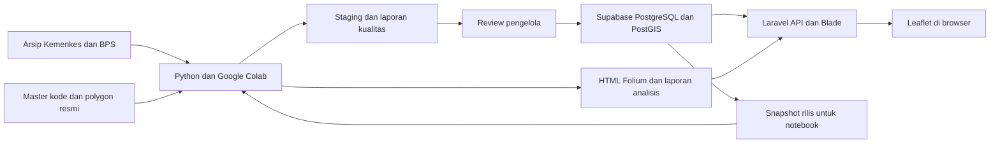

# Arsitektur aplikasi dan metode analisis

## Keputusan teknologi

| Komponen | Pilihan yang direncanakan | Alasan dan batas |
|---|---|---|
| Backend | Laravel 13, PHP minimal 8.3, Composer | Mempertahankan framework proposal; periksa kompatibilitas Laragon sebelum instalasi |
| UI | Blade, CSS responsif, JavaScript lewat Vite | Cukup untuk skala penelitian; tidak perlu menambah SPA terpisah |
| Peta web | Leaflet dan plugin marker cluster yang kompatibel | Filter dinamis, popup, GeoJSON dan layer dari API Laravel |
| Database | Supabase PostgreSQL + PostGIS | Relasi, integritas data, indeks spasial dan analisis geografi |
| Pipeline | Python 3.12; pandas, GeoPandas, Shapely, pyproj, Folium, geopy, pytest | Pembersihan, validasi, analisis dan keluaran penelitian |
| Lingkungan penelitian | Google Colab + notebook di repositori | Memenuhi proposal dan memungkinkan reproduksi run |
| Autentikasi internal | Laravel session authentication dan authorization policies | Satu sistem akun; Supabase Auth tidak diperlukan pada rancangan awal |
| Pengujian | PHPUnit/Pest, pytest, Playwright, SQL assertions, k6 bila tersedia | Masing-masing untuk backend, analisis, browser, database, performa |
| Hosting | Hosting PHP yang mendukung Laravel, HTTPS, queue/cron dan koneksi PostgreSQL | Hosting statis saja tidak menjalankan backend Laravel |

Versi minor dan dependency lock ditetapkan saat inisialisasi, setelah smoke test Windows, Colab dan hosting. Hindari mematok versi dari dokumentasi prarilis. [Persyaratan Laravel](https://laravel.com/framework/docs/13.x/deployment), [referensi Leaflet](https://leafletjs.com/reference.html).

## Alur komponen



Colab tidak perlu mendapat kredensial produksi. Jalur awal: unduh snapshot terpilih yang disanitasi, jalankan analisis, lalu impor hasil melalui perintah backend pengelola. Browser hanya berkomunikasi dengan Laravel. Tugas berat dijalankan offline atau lewat worker; permintaan peta tidak memanggil Colab/geocoder dan tidak menghitung ulang seluruh polygon.

Leaflet menjadi peta aplikasi yang dinamis. Folium menghasilkan artefak HTML penelitian per rilis. Kedua keluaran memakai dataset dan definisi indikator yang sama, dengan `release_id` dan `analysis_run_id` yang ditampilkan. File HTML Folium dapat membutuhkan internet untuk tile/CDN; ekspor HTML bukan jaminan peta offline. Untuk demo tanpa internet, siapkan dependency lokal dan basemap yang lisensinya mengizinkan penggunaan offline.

## Struktur repositori yang disarankan saat implementasi

```text
Archives/                         sumber asli yang dibaca
Planning/                         paket rencana ini
app/Http/Controllers/Api/          API baca, filter dan detail
app/Services/                     agregasi indikator, ekspor, publikasi
app/Policies/                     otorisasi admin
resources/views/                  Blade dan layar metodologi
resources/js/map/                  layer, filter, legenda dan popup
routes/web.php                    halaman dan admin
routes/api.php                    kontrak API baca
database/migrations/              satu sumber riwayat schema dan grants
database/seeders/                  referensi kategori, bukan data palsu produksi
scripts/etl/                      extract, normalize, validate, publish input
notebooks/                        pipeline Colab dan peta Folium
data/staging/                     hasil ekstraksi yang belum disetujui
data/processed/<release_id>/       keluaran terverifikasi dan manifest
tests/Feature/                    API, akses dan impor Laravel
tests/Browser/                    alur browser
tests/data/                       fixture sintetis
tests/python/                     unit indikator dan spasial
docs/                             panduan instalasi, metode, UAT dan laporan
```

Arsip besar, output sementara, `.env`, cache geocoder, database dump dan rahasia tidak dimasukkan Git tanpa pertimbangan ukuran/hak akses. Repositori menyimpan kode, lockfile, migration, metadata sumber, manifest hash dan fixture kecil. Data penelitian asli dibackup terpisah.

## Kontrak API awal

Semua endpoint menerima `release_id`; bila dihilangkan, server memilih rilis publik aktif sekali pada awal request dan mengembalikan identitasnya. Frontend mempertahankan ID tersebut untuk semua request satu sesi tampilan. Rilis yang belum terbit tidak dapat dibaca publik.

| Endpoint GET | Parameter utama | Keluaran |
|---|---|---|
| `/api/v1/releases` | — | Daftar rilis publik, periode sumber, kualitas dan rilis aktif |
| `/api/v1/regions` | `level`, `parent_id` | Pilihan kabupaten/kecamatan resmi |
| `/api/v1/facilities` | `q`, `regency_id`, `district_id`, `service_type`, `area_type`, `coordinate_status`, `page`, `per_page` | Tabel fasilitas, termasuk tanpa koordinat |
| `/api/v1/facilities/{code}` | `release_id` | Detail snapshot fasilitas dan sumber |
| `/api/v1/map/points` | filter fasilitas, `bbox` opsional | GeoJSON titik dan ringkasan registered/mapped/verified/missing |
| `/api/v1/map/regions` | `level`, `parent_id`, `metric`, `geometry_detail` | GeoJSON polygon yang disederhanakan + indikator |
| `/api/v1/statistics` | `regency_id`, `district_id` | Agregasi administratif semua fasilitas dalam cakupan |
| `/api/v1/analysis/buffers` | `run_id`, `radius_m`, `regency_id` | Polygon buffer hasil run publik, cakupan input dan metadata |
| `/api/v1/sources` | `release_id` | Sumber publik, tahun, unit, metodologi |
| `/api/v1/exports/facilities.csv` | filter tabel; P1 | CSV dan metadata periode, format angka konsisten |

`per_page` default 50 maksimal 100; `q` maksimal 100 karakter; sort/metric/geometry_detail memakai allowlist. `bbox` empat angka lon-min,lat-min,lon-max,lat-max dengan rentang valid. Batas `radius_m` awal hanya 1000, 3000, 5000; radius lain memerlukan run baru, bukan SQL arbitrer dari klien. API point provinsi boleh mengirim sampai 973 titik snapshot sekaligus bila hasil ukur payload memenuhi target; paging tabel tetap terpisah dan tidak boleh membuat titik peta hilang diam-diam.

Respons memiliki `meta.release_id`, `source_periods`, `coordinate_coverage`, `warnings`, `generated_at`; paginasi menambahkan `total`, `page`, `per_page`. GeoJSON memakai `[longitude, latitude]`, sementara pemanggilan Leaflet yang menerima array LatLng memakai `[latitude, longitude]`. GeoJSON fasilitas yang tidak punya koordinat dikeluarkan dari layer titik tetapi tetap muncul di tabel.

Error: 400 untuk parameter tak dikenal/format salah, 422 untuk validasi nilai, 401/403 untuk akses admin, 404 untuk kode/rilis tidak tersedia publik, 429 untuk rate limit, 503 untuk ketergantungan yang gagal. Pesan publik tidak menampilkan SQL, password, path internal atau stack trace.

Filter pelayanan/karakteristik memengaruhi daftar dan marker. Indikator kebutuhan administratif tetap memakai seluruh fasilitas dalam wilayah; jika UI menyediakan rasio subset, tampilkan sebagai indikator terpisah dengan nama pembilang yang eksplisit. Hindari indikator “defisit total” yang berubah hanya karena pengguna memfilter rawat inap.

## Definisi indikator

Untuk satu kecamatan dan rilis, definisikan `P` jumlah penduduk, `A` luas statistik km², `F` jumlah fasilitas administratif dan `T` parameter rasio, default 30.000 jiwa/fasilitas. `F` berasal dari master fasilitas setelah mapping, bukan banyaknya marker.

| Indikator | Formula | Perlakuan kondisi khusus |
|---|---|---|
| Kepadatan | `P / A` jiwa/km² | Null bila P hilang atau A hilang/tidak positif |
| Penduduk per puskesmas | `P / F` | F=0: nilai numerik null dan status `tanpa_puskesmas`; jangan menulis 0 |
| Puskesmas per 30.000 penduduk | `F * 30000 / P` | P=0 atau hilang: null; simpan angka penuh, bulatkan saat tampil |
| Kebutuhan indikatif berbasis rasio | `ceil(P / T)` | P hilang: null; P=0 menghasilkan 0 untuk rumus demografi |
| Defisit indikatif | `max(0, ceil(P/T) - F)` | Null bila input tidak lengkap; bukan keputusan pembangunan |
| Kecamatan tanpa puskesmas | `F == 0` | Indikator terpisah dari kebutuhan demografi, termasuk bila P=0 |
| Rasio agregat kabupaten | `sum(P) / sum(F)` | Jangan rata-rata rasio kecamatan; hanya subset dengan kelengkapan yang dinyatakan |
| Defisit kabupaten | `sum(defisit_kecamatan)` | Berbeda dengan `max(0, ceil(sum(P)/T)-sum(F))`; jangan dipertukarkan |
| Kelengkapan koordinat | `jumlah pasangan koordinat / F * 100%` | Dibedakan dari persentase titik terverifikasi |
| Titik layak buffer | `verified facility points / F * 100%` | Keluarkan missing, rejected dan centroid wilayah |

Pasal 10 juga mengatur minimal pendirian di setiap kecamatan. Karena itu flag `tanpa_puskesmas` tetap terpisah dari formula demografi, dan kasus penduduk nol tetap perlu ditinjau. Tahun fasilitas 2024-S1 versus penduduk 2023 harus selalu disebut di hasil rasio. T=30.000 merupakan parameter yang ditelusuri ke sumber; versi analisis menyimpan nilai T. [Permenkes 19/2024 Pasal 10](https://jdih.kemkes.go.id/storage/documents/pdfs/2024permenkes019.pdf).

Contoh data arsip untuk pemeriksaan manual: Arosbaya, P=46.790 dan F=2 → rasio 23.395; kebutuhan 2; defisit 0. Kecamatan Bangkalan, P=89.550 dan F=1 → rasio 89.550; kebutuhan 3; defisit 2. Contoh ini memakai nilai workbook dan belum merupakan hasil penelitian final.

## Choropleth dan pemeringkatan

Layer P0: jumlah fasilitas, kepadatan penduduk, penduduk per fasilitas, defisit indikatif. Untuk rasio gunakan kelas transparan yang diusulkan tim: ≤30.000; >30.000–60.000; >60.000; tanpa puskesmas; data belum lengkap. Batas 60.000 adalah kelas visual, bukan ambang hukum tambahan. Indikator lain memakai kelas tetap yang disimpan pada run atau quantile yang dijelaskan; legenda menyebut metode dan unit.

No-data diberi arsiran/abu-abu, bukan warna nilai nol. Perubahan filter tidak boleh menyembunyikan pergantian skala warna. Ranking P1 mengurutkan defisit menurun, lalu rasio menurun, kemudian kode wilayah sebagai tie-breaker. Kecamatan tanpa F ditampilkan dengan status yang jelas, tanpa mengirim nilai infinity dalam JSON. Jangan menyusun skor berbobot kepadatan/coverage tanpa alasan penelitian yang disepakati.

## Buffer dan luas cakupan

1. Simpan titik dan polygon asli dalam WGS84 EPSG:4326. Urutan titik PostGIS adalah lon,lat.
2. Untuk radius 1/3/5 km, gunakan `ST_Buffer(point::geography, radius_m)` atau buffer per titik pada CRS metrik lokal yang benar, lalu kembali ke WGS84. Geometry EPSG:4326 memakai derajat, sehingga `.buffer(3000)` pada data tersebut tidak sah sebagai 3 km. [ST_Buffer](https://postgis.net/docs/ST_Buffer.html), [transformasi CRS GeoPandas](https://geopandas.org/en/stable/docs/reference/api/geopandas.GeoSeries.to_crs.html).
3. Gunakan ketelitian kurva yang ditetapkan (`quad_segs=32` sebagai usulan) dan uji jarak radius. Jangan memakai satu zona UTM secara sembarang untuk seluruh Jawa Timur dan kepulauannya; pilih metode geodesik atau proyeksi sesuai extent.
4. Union/dissolve buffer fasilitas sebelum menghitung luasan agar overlap tidak menambah luas dua kali. Intersect union dengan polygon wilayah analisis.
5. Luas cakupan geometris = `area(intersection) / area(polygon wilayah) * 100%`, keduanya dihitung dengan metode geodesik/proyeksi yang sama. Penyebut ini adalah luas polygon, bukan otomatis luas statistik BPS. Jika polygon mencakup perairan, jelaskan definisinya; klaim luas daratan memerlukan mask daratan.
6. Buffer satu kabupaten tetap dapat dipengaruhi fasilitas tetangga di Jawa Timur. Untuk analisis wilayah, ambil seluruh titik dalam radius dari batas wilayah lalu clip hasil. Beri label keterbatasan fasilitas di luar Jawa Timur yang tidak ada di dataset.
7. Simpan jumlah fasilitas terdaftar, terverifikasi dan dikeluarkan pada setiap hasil. Jangan mengubah cakupan area menjadi persentase penduduk terlayani tanpa distribusi penduduk yang mendukung.

Radius tidak mewakili waktu perjalanan, layanan aktual, kapasitas, atau wilayah kerja resmi. Untuk menguji aksesibilitas 60/120 menit dalam Pasal 10 dibutuhkan jaringan transportasi, asal desa/kelurahan, moda lokal dan data perjalanan. Fitur tersebut diletakkan pada P2.

## Cache dan eksekusi

Gunakan cache key `release_id + analysis_run_id + filter + metric + geometry_detail`. Publikasi rilis baru menghasilkan key baru; rilis lama tetap dapat direproduksi. Polygon display disederhanakan dengan menjaga topology; geometri penuh tetap dipakai analisis. Siapkan indeks GiST pada titik/polygon dan indeks B-tree pada release, kode dan FK wilayah. Hasil buffer provinsi dibuat per run; permintaan browser hanya membaca hasilnya.

Notebook dibagi menjadi tahap input/manifest, validasi, mapping, koordinat, indikator, buffer, visualisasi, dan ekspor. Setiap tahap gagal dengan pesan spesifik jika dependensi belum lengkap. Run tidak boleh otomatis mempromosikan dataset yang gagal validasi.
