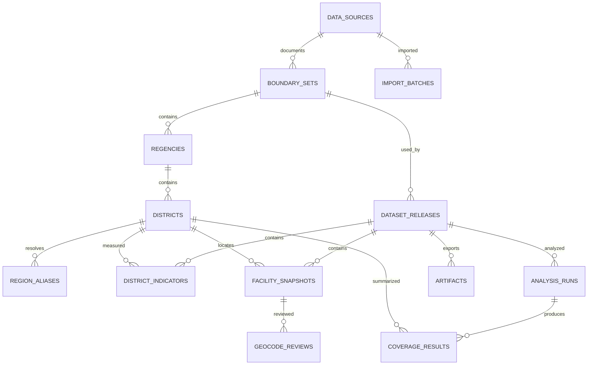

# Rancangan Supabase dan kamus data

## Cara integrasi yang dipilih

Supabase dipakai sebagai layanan **PostgreSQL dan PostGIS**. Laravel mengaksesnya melalui koneksi PostgreSQL server. Akun admin menggunakan tabel/session Laravel; rancangan awal tidak memakai Supabase Auth atau query database langsung dari browser. Gunakan schema `app` untuk akun aplikasi, `gis` untuk domain penelitian, dan `staging` untuk input mentah.

Koneksi menggunakan Session Pooler atau direct connection yang sesuai jaringan, SSL wajib, dan kredensial disimpan di environment server. Schema aplikasi tidak dimasukkan ke exposed schema Data API. Bila REST/GraphQL Supabase tidak dipakai, nonaktifkan Data API. Ini mengikuti jalur yang dijelaskan dalam [integrasi Laravel](https://supabase.com/docs/guides/getting-started/quickstarts/laravel) dan [pengamanan Data API](https://supabase.com/docs/guides/api/securing-your-api). PostGIS harus diaktifkan dan lokasi schema extension dicatat sebelum migration spasial dibuat. [Panduan PostGIS Supabase](https://supabase.com/docs/guides/database/extensions/postgis).

Dokumen ini adalah desain target. SQL yang disertakan hanya menyiapkan **staging perencanaan**, bukan seluruh migration aplikasi. Tidak ada SQL yang telah dijalankan pada Supabase.

## Model hubungan

UUID menjadi ID internal; kode resmi tetap `text` agar format/leading zero terjaga. Identitas historis dipisahkan dari nama tampilan. Target baseline wilayah adalah 38 kab/kota dan 666 kecamatan untuk edisi 2023, setelah rekonsiliasi resmi. Jumlah 973 berlaku untuk rilis fasilitas 2024-S1, bukan constraint global untuk semua rilis masa depan.

## Kamus tabel target

Kolom wajib ditandai NOT NULL dalam migration implementasi. `created_at`/`updated_at` memakai `timestamptz` dan UTC; antarmuka dapat menampilkan Asia/Jakarta. FK menggunakan restrict untuk data penelitian, bukan cascade delete yang menghilangkan riwayat.

### data_sources

| Kolom | Tipe | Aturan |
|---|---|---|
| id | uuid PK | Identitas sumber/edisi |
| publisher, title | text | Wajib |
| source_url, local_path | text nullable | Minimal salah satu terisi |
| publication_year | smallint nullable | Tahun terbit, bukan observasi |
| reference_period | text | Misalnya `2024-S1`, `2023`, atau `mixed`; wajib |
| table_reference, page_reference | text nullable | Jejak tabel/halaman; untuk nilai turunan bisa pada metadata baris |
| retrieved_at | timestamptz nullable | Tidak memalsukan tanggal unduh berkas lama |
| sha256 | text | 64 karakter heksadesimal untuk berkas lokal |
| license_note, limitations | text | Syarat penggunaan dan batas data |
| verification_status | text | pending/verified/rejected |

### boundary_sets, regencies dan districts

| Tabel | Kolom utama | Constraint dan indeks |
|---|---|---|
| boundary_sets | id uuid; name text; reference_year smallint; code_system text; source_id FK; source_crs text; version text | Version wajib; tahun tak diketahui tidak ditebak |
| regencies | id uuid; boundary_set_id FK; official_code text; official_name text; kind text; geom MultiPolygon(4326); geom_display MultiPolygon(4326) nullable | Unique(set,code); kind kabupaten/kota; polygon valid/nonempty; GiST geom |
| districts | id uuid; regency_id FK; official_code text; official_name text; geom MultiPolygon(4326); geom_display nullable | Unique(regency,code); kode sumber bukan hasil potong kode puskesmas; GiST geom |
| region_aliases | id uuid; source_id FK; raw_regency text; raw_district text; district_id FK; mapping_kind text; review_status text; evidence text; reviewed_by FK; reviewed_at timestamptz | Unique(source,raw_regency,raw_district); mapping_kind spelling/rename/code_crosswalk; status pending/approved/rejected; hanya approved masuk ETL |

Nama dan kode dua sistem yang berbeda tidak disamakan tanpa crosswalk. Parent distrik menentukan boundary set. Pemeriksaan publikasi memastikan semua district_id pada rilis berada dalam boundary_set_id rilis; implementasikan dengan FK komposit/trigger atau constraint yang setara dan uji I03. Alias many-to-one diperbolehkan bila terbukti perubahan nama, tetapi jangan menjumlah ulang observasi penduduk yang sama.

### dataset_releases

| Kolom | Tipe | Aturan |
|---|---|---|
| id, label | uuid PK, text unique | Identitas rilis permanen |
| boundary_set_id | uuid FK | Satu edisi polygon/master per rilis |
| facility_period | text | `2024-S1` pada baseline |
| population_policy, area_policy | text | Satu tahun atau campuran dengan penjelasan |
| status | text | draft/validated/published/withdrawn |
| source_manifest | jsonb | Daftar source_id dan hash input; bukan pengganti FK sumber pada fakta |
| method_version, code_revision | text | Versi formula dan kode |
| quality_summary | jsonb | Jumlah missing, unverified, konflik wilayah dan keputusan |
| published_at, published_by | timestamptz, FK user nullable | Wajib bila published |

Rilis published tidak dapat diubah oleh runtime/worker. Koreksi menghasilkan rilis baru. Penunjuk rilis aktif dapat disimpan satu baris `app.settings`; publish dan pergantian penunjuk dalam satu transaksi. Diperlukan satu validator pusat untuk transisi draft → validated → published.

Worker tidak mendapat izin memperbarui kolom status/published_at/published_by secara langsung. Transisi publikasi dilakukan lewat fungsi atau command transaksi yang hanya dapat dipanggil role publisher, setelah memeriksa semua prasyarat. Trigger/constraint menjaga immutability rilis dan anaknya; ini harus tetap berlaku saat ada kesalahan implementasi aplikasi. Sumber dan boundary set yang dapat dibaca runtime dibatasi pada yang dirujuk rilis published, bukan seluruh bahan internal.

### district_indicators

| Kolom | Tipe | Aturan |
|---|---|---|
| release_id, district_id | uuid FK, composite PK | Satu observasi gabungan terpilih per kecamatan/rilis |
| population | bigint nullable | ≥0; null berarti belum diketahui |
| population_year | smallint nullable | Wajib jika population terisi |
| population_source_id | uuid FK nullable | Wajib jika population terisi |
| population_locator | text nullable | Sheet/baris atau tabel/halaman sumber |
| area_km2 | numeric(16,6) nullable | >0 bila terisi |
| area_year | smallint nullable | Wajib jika area terisi |
| area_source_id | uuid FK nullable | Wajib jika area terisi |
| area_locator | text nullable | Jejak nilai asli |
| quality_status, notes | text | valid/review/blocked; penjelasan sumber campuran |

Jumlah fasilitas dan rasio tidak diisi manual pada tabel ini. Buat view hasil hitung dari facility_snapshots yang tepat rilisnya. Luas statistik BPS dan luas polygon hasil PostGIS tetap merupakan dua besaran terpisah.

### facility_snapshots

| Kolom | Tipe | Aturan |
|---|---|---|
| release_id, facility_code | uuid FK, text; composite PK | Satu kode per rilis; baseline panjang 11 digit, validasi berdasarkan spesifikasi sumber |
| district_id | uuid FK | Wajib sebelum publikasi |
| name, address | text | Nama wajib; alamat mentah dipertahankan |
| service_type | text | Rawat Inap / Non Rawat Inap |
| area_type | text | Perdesaan / Perkotaan / Terpencil / Sangat Terpencil |
| source_id, source_row | uuid FK, integer | Bukti fasilitas dari master |
| location | geometry(Point,4326) nullable | Satu sumber kebenaran spasial; lon/lat API diturunkan dari point |
| coordinate_status | text | missing/unverified/verified/rejected |
| precision_level | text | facility/street/village/district/regency/unknown |
| coordinate_source_id | uuid FK nullable | Sumber koordinat terpilih |
| selected_review_id | uuid nullable | FK ke review yang dimiliki fasilitas dan rilis yang sama |

`missing` mengharuskan location null. `verified` mengharuskan point valid, precision facility, review berstatus accepted, sumber dan reviewer. Point kandidat yang ditolak dapat disimpan pada tabel review, sedangkan snapshot tidak menggunakannya untuk analisis. Rentang global latitude/longitude wajib valid; polygon containment tetap perlu uji spasial. Jangan memakai batas kotak sempit yang menghilangkan pulau terluar.

### geocode_reviews

Kolom: `id uuid PK`, `release_id`, `facility_code` FK komposit, `candidate_location Point(4326) nullable`, `provider text`, `query text`, `provider_object_id text nullable`, `precision_level text`, `raw_response jsonb nullable`, `evidence_url text nullable`, `evidence_note text`, `result_status text`, `reviewed_by user FK nullable`, `reviewed_at timestamptz nullable`, `decision_reason text`. Hasil diterima wajib punya bukti dan reviewer. Simpan beberapa kandidat; memilih satu kandidat memperbarui snapshot draft dengan transaksi. Indeks pada `(release_id, facility_code)` dan review_status.

### analysis_runs dan coverage_results

| Tabel | Isi | Aturan |
|---|---|---|
| analysis_runs | id UUID; release_id FK; method_version; code_revision; input_hash; parameters JSONB; started_at/finished_at; status; output_manifest JSONB | parameters memuat T, radius, metode area, CRS, quad_segs, aturan inclusion dan versi pustaka; succeeded hanya jika validasi lewat |
| coverage_results | run_id FK; district_id FK; radius_m integer; covered_area_km2 numeric; geometry_area_km2 numeric; coverage_pct numeric; geom MultiPolygon(4326) nullable; included_facilities integer; excluded_facilities integer | PK(run,district,radius); radius positif; persentase 0–100 dengan toleransi numerik; FK district sesuai rilis run |
| artifacts | id UUID; release_id FK; analysis_run_id FK nullable; kind text; path text; sha256 text; bytes bigint; generated_at | HTML/CSV/GeoJSON/laporan, referensi run dan rilis konsisten |

Metric tabular dapat berupa view atau materialized view dengan key release/district/method. Hindari menyimpan satu rasio bebas tanpa keterkaitan sumber dan parameter. Agregasi persentase coverage provinsi dihitung dari luas total konsisten, bukan rata-rata persentase kecamatan.

### import_batches dan audit_logs

`import_batches`: id, source_id, file_hash, pipeline_version, target_release_id, started_by, timestamps, status, row_count, accepted_count, rejected_count dan error_report_path. Kombinasi hash dan versi pipeline membantu idempotensi. Impor dua kali tidak menambah dua fasilitas dengan kode yang sama.

`audit_logs`: id, actor_id, action, entity_type, entity_key, before_json, after_json, request_id, created_at. Hak runtime hanya append untuk kegiatan yang diizinkan, bukan update/delete audit. Jangan mencatat password/token. Jika actor system, gunakan identitas job, bukan identitas pengguna palsu.

Tabel `app.users`, `app.sessions`, `app.jobs` dan reset token mengikuti migration Laravel serta policies aplikasi. Role pengelola/admin ditetapkan server, tidak dapat diubah melalui form profil umum.

## Akses database dan RLS

| Identitas | Hak yang diperlukan | Pembatasan |
|---|---|---|
| Pengunjung browser | HTTP GET Laravel | Tidak mendapat DB password atau Supabase secret |
| Runtime Laravel | Baca dataset published; kelola session/akun sesuai fungsi | Non-owner, tanpa BYPASSRLS, tanpa DDL, tanpa akses staging |
| Worker impor/review | Baca/tulis staging dan rilis draft | Tidak mengubah published; operasi review melalui command terotorisasi |
| Publisher | Transisi rilis setelah validator lolos | Akun server terpisah, audit, tanpa akses dari browser |
| Migration owner | DDL dan grant | Hanya deployment terkontrol; bukan koneksi harian aplikasi |
| Supabase anon/authenticated | Tidak ada hak schema app/gis/staging pada desain awal | Tidak ada policy `using(true)` atau izin tulis publik |

RLS direncanakan pada tabel domain, dengan grant minimum dan policy berdasarkan database role serta status rilis. Akun Laravel tidak otomatis menjadi `auth.uid()` Supabase; jangan menulis policy Supabase Auth untuk koneksi PDO yang tidak membawa identitas itu. RLS hanya pertahanan tambahan: middleware dan policies Laravel tetap mengatur pengguna aplikasi. Table owner dan role BYPASSRLS dapat melewati RLS; pengujian wajib memakai runtime role yang sebenarnya. View memakai security-invoker jika tersedia, atau jalur aman ekuivalen; fungsi security-definer memerlukan alasan, search_path tetap dan grant execute terbatas. [RLS Supabase](https://supabase.com/docs/guides/database/postgres/row-level-security).

Jika kelak browser perlu Data API/Supabase Auth, buat keputusan arsitektur baru, schema API khusus, policy per operasi, dan pengujian seluruh role. Jangan hanya mengaktifkan public schema pada desain ini.

## Persiapan dan urutan impor

1. Buat environment development/test dan production terpisah. Catat project ref/region/versi PostgreSQL; rahasia di secret manager/environment.
2. Aktifkan PostGIS dan konfirmasi schema extension. Aktifkan SSL dan connection pool sesuai Laravel; batasi jumlah worker/koneksi.
3. Buat migration satu kali dari Laravel untuk schema/tabel/index/grants/policies. Jangan menjalankan dua rangkaian migration Laravel dan Supabase yang saling mengelola tabel sama.
4. Impor raw source ke staging, rekam source dan batch. Gunakan `COPY`/import job transaksi untuk CSV; penetapan tipe final dilakukan setelah validasi.
5. Urutan kurasi: sumber → boundary set → kabupaten → kecamatan → alias → release draft → indikator → fasilitas → review koordinat → run analisis → artefak.
6. Tolak FK/yield yang tidak sah, duplikat kode, nilai negatif dan status palsu. Simpan baris gagal di laporan; jangan mengabaikannya.
7. Jalankan rekonsiliasi jumlah dan pengujian. Promosikan release hanya setelah quality gate.
8. Uji publish dan rollback. Rollback aplikasi memilih release lama, bukan menghapus data baru; migration berisiko memerlukan backup dan prosedur tersendiri.

## Bahan Supabase yang tersedia dalam paket

- [SQL staging](bahan/supabase_staging.sql): tiga tabel staging yang kolomnya cocok dengan tiga CSV utama, grants publik dicabut dan RLS aktif. Jalankan hanya saat tahap implementasi pada database test baru. Tidak membuat role, akun atau migration produksi.
- [SQL pemeriksaan staging](bahan/pemeriksaan_staging.sql): pemeriksaan jumlah, kategori, kelengkapan koordinat dan subtotal setelah impor. Query ini baru menjadi bukti eksekusi setelah benar-benar dijalankan di PostgreSQL.
- `staging_puskesmas_2024_s1.csv`: 973 fasilitas, `coordinate_review_status` belum terverifikasi, semua `eligible_for_buffer=false`.
- `staging_kecamatan_gabungan.csv`: 667 detail asli, termasuk nilai kosong; belum memiliki kode wilayah resmi/tahun per baris.
- `jumlah_puskesmas_tanpa_total.csv`: 665 pasangan nama mentah, total 973; belum mencakup master lengkap kecamatan tanpa fasilitas.

Tiga CSV ini **tidak boleh langsung diimpor ke tabel produksi final**. Kolom kode wilayah, tahun, sumber indikator dan bukti lokasi harus dilengkapi melalui kurasi. `eligible_for_buffer` pada CSV hanyalah penanda awal; pada database final status kelayakan dihitung dari constraint dan review, bukan dipercaya dari unggahan pengguna.

## Operasional dan backup

Gunakan backup database terjadwal dan salinan berkas sumber/artefak secara terpisah. Backup database tidak otomatis menjamin seluruh objek Storage telah tersalin. Ketersediaan backup/PITR tergantung paket yang dipilih; anggaran dan retensi diverifikasi saat setup. [Dokumentasi backup Supabase](https://supabase.com/docs/guides/platform/backups).

Target proyek: backup harian, salinan sebelum impor/migration penting, retensi minimal selama periode penilaian yang disepakati, uji restore ke environment test. Monitor error impor, koneksi, lama query, ukuran polygon, egress, penggunaan storage, status job dan tanggal backup terakhir. GeoJSON/HTML publik hanya boleh berisi data rilis terbit, tanpa kredensial atau raw response internal yang tidak diperlukan.
