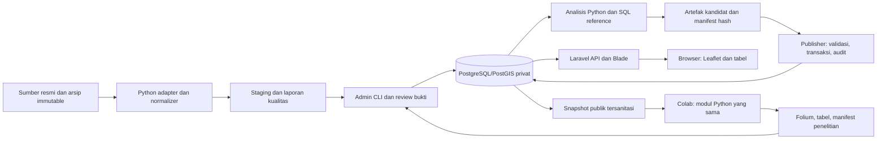

# Arsitektur komponen

Versi 1 · 23 Oktober 2026 · Penyusun: Codex · Desain kandidat, bukan sistem yang sudah dibangun.

Browser hanya HTTP ke Laravel dan provider tile yang diizinkan. Laravel memilih rilis published sekali per request; frontend mematok release_id dan run_id satu sesi tampilan. Tidak ada kredensial Supabase di JS/Folium/Colab. Source raw dan staging tidak berada di webroot.

| Komponen / lokasi proses | Tanggung jawab | Batas |
|---|---|---|
| Browser | UI state, filter, legend, render GeoJSON, tabel alternatif | Tidak menghitung ulang indikator resmi atau query DB privat |
| Laravel web | Auth admin/session, public API, validasi request, cache rilis | Koneksi runtime non-owner; tanpa credential publisher |
| Python batch | Acquire/normalize/validate, kurasi input, analisis dan ekspor | Input manifest versioned; tidak mengganti pointer aktif |
| CLI operator | Autentikasi actor, review, dispatch batch, publish/rollback | Kewenangan operasi diperiksa; identitas bukan sekadar flag --actor |
| Postgres/PostGIS | FK/constraint/RLS/immutability, transaksi lifecycle | Source of truth data/rilis; satu jalur migration Laravel |
| Storage | Raw private, artefak draft private, objek immutable berhash | Publik hanya snapshot/artefak rilis terbit tersanitasi |
| Colab | Reproduksi rilis dengan wheel/module revision yang sama | Tidak memakai produksi; koneksi internet untuk input/tile dijelaskan |

FR-01/02/09 melalui sumber→staging→DB; FR-03/04/10/11/12/13 melalui DB→API→UI; FR-05/06 melalui analisis versioned; FR-07 melalui snapshot→Colab; FR-08 stack komponen; FR-15 melalui CLI/auth; FR-17 melalui CI/tes. FR-14/16 dan UI admin opsional mengikuti keputusan P1 yang belum final. Desain inti tidak bergantung pada P1. Referensi kebutuhan: [SRS](../WF-028/SRS-baseline.md).
