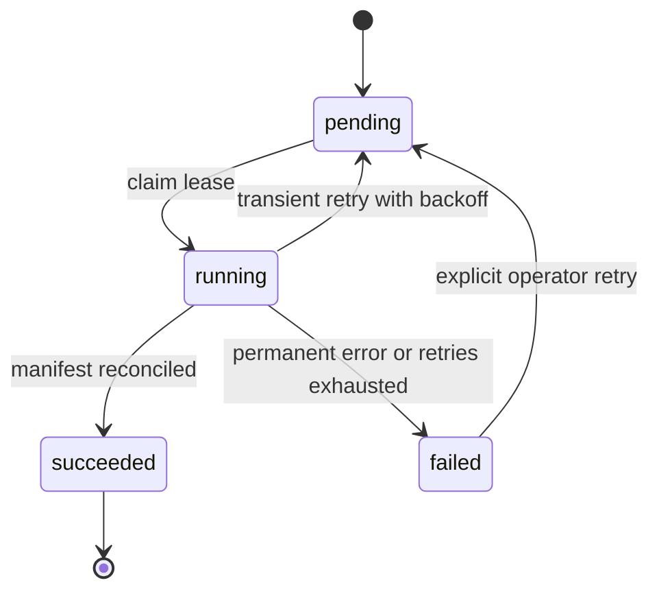

# Batch, checkpoint dan idempotensi

Versi 1 · 23 Oktober 2026 · Penyusun: Codex.

Idempotency key = SHA256(canonical JSON {source_hash, source_id, target_release_id, pipeline_version, operation, parameters_hash}). Include release target so identical input can intentionally seed a new draft. Unique key in import_batches/analysis_runs; concurrent submissions return existing job. Retry continues same identity and increments attempt, never appends duplicate facility rows. New input/code/parameter means new key/run.

Worker claims atomic row lock with lease_until and heartbeat every30s; lease5min, chunk writes transactional. Crash recovery only reclaims expired lease and records prior attempt; finalization compares attempt/lease token so a stale worker cannot succeed after takeover. Persist chunk start/end/count/hash and last committed cursor. File output uses temporary private path then atomic rename/hash, not published URL.

Geocode/review chunks ≤25 stable facility codes, ordered code ascending. Persist initial queue hash, pending/blocked/completed and evidence per code; resumed queue must reconcile completed+pending+blocked=initial. A changed input hash requires explicit new queue/reconciliation. Missing evidence is blocked, not completed verified. Human review is not automatically retried as if a network call.

Success requires expected source pages/IDs and accepted+quarantined+aggregate rows=raw rows, with no missing pages. A parser may finish with quarantine report, but that does not validate/promote the release. Pipeline success and data quality gates are distinct. Analysis succeeded requires output manifest/hash and reconciled eligibility; publisher alone performs release transitions.
