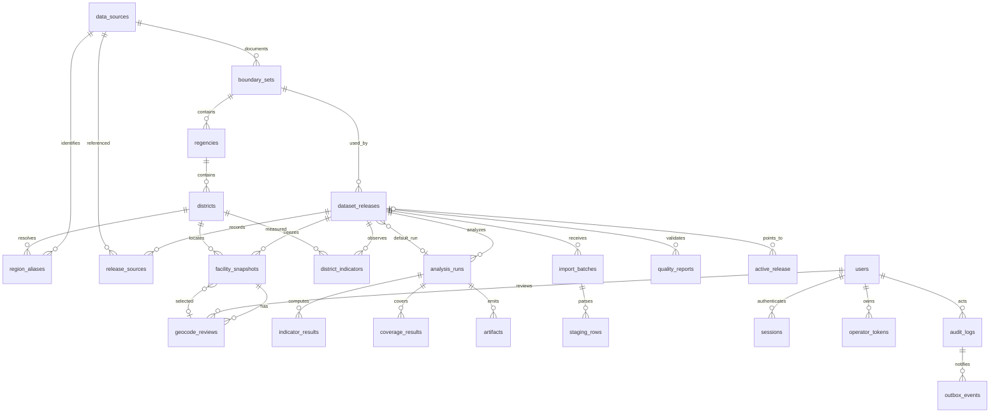

# ERD kandidat implementasi

Versi 1 · 23 Oktober 2026 · Penyusun: Codex. Finalisasi teknis untuk review, belum deployment atau accepted eksternal. Semua kolom dan FK dijelaskan dalam [kamus](kamus-data-final.md).

Cardinalité optionnelle selected/default digambarkan sebagai relasi nullable; FK komposit mengikat review→fasilitas→rilis dan run→rilis. Hubungan sumber observasi memakai FK source_id dan locator, bukan manifest JSON saja. Regencies/districts membawa boundary_set_id eksplisit agar constraint lintas edisi dapat ditegakkan. Alur draft memiliki siklus review terpilih/default run; FK ditambahkan sesudah tabel ada, deferrable bila transaksi insert membutuhkan.

Tambahan terhadap planning awal: release_sources, indicator_results per run, quality_reports immutable, singleton active_release, operator_tokens dan outbox_events. Tujuannya menghilangkan rasio tanpa parameter, FK lintas rilis, audit terpisah transaksi dan actor CLI yang dapat dipalsukan dengan flag. Bukan fitur produk baru. Nama tabel teknis app.jobs/failed_jobs mengikuti driver queue framework pada migration, tidak mengubah model penelitian.
