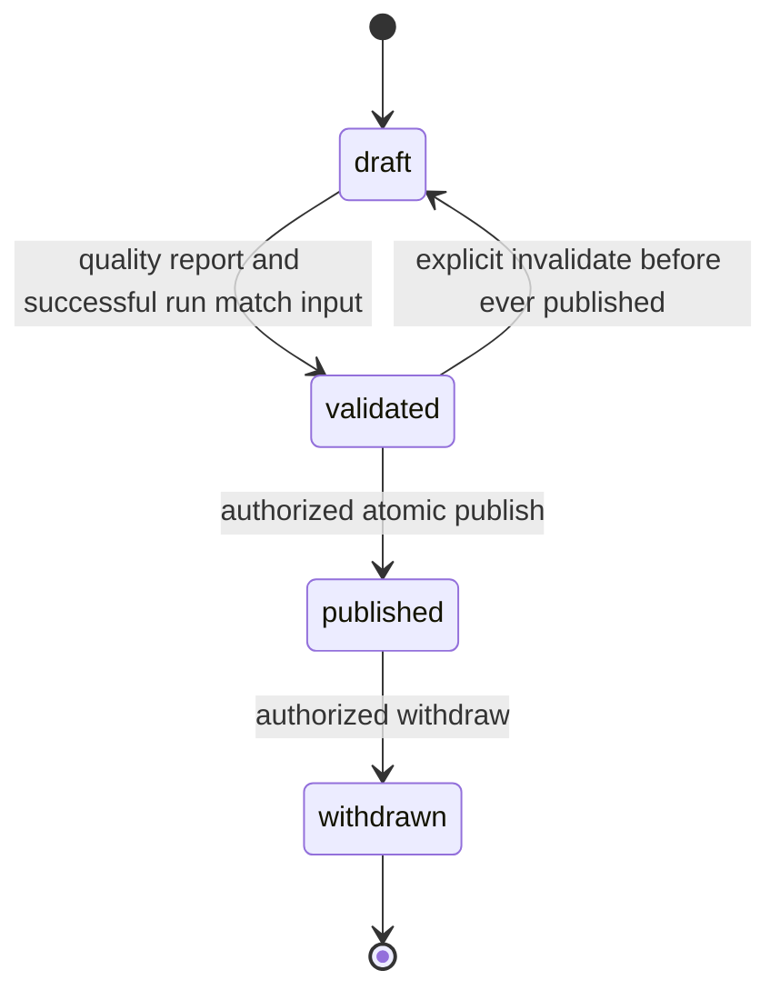

# Lifecycle rilis, transaksi dan cache

Versi 1 · 23 Oktober 2026 · Penyusun: Codex.

Published tidak kembali draft. Withdrawn tidak dipublish ulang; koreksi membentuk rilis baru. Rollback memilih release previously published yang masih published; rilis aktif sebelumnya tetap published kecuali withdraw eksplisit. Pointer menyimpan release_id dan default_analysis_run_id pasangan sah; request run berbeda release ditolak. Semua rilis publik dapat dibaca eksplisit sampai withdrawn.

Enam checkpoint WF-086: (1) review selection berbukti + actor; (2) analyze creates versioned run; (3) validate membekukan input_revision/hash dan report; (4) publish atomic; (5) rollback pointer; (6) audit/cache/error/concurrency. Setiap checkpoint mempunyai fixture/negative case sebelum langkah berikutnya.

Publish transaction: autentikasi token/ability → lock active singleton FOR UPDATE → cocokkan expected version → lock candidate release → cocokkan report/input revision/hash/method/run succeeded/artifact hashes dan scope accepted → update candidate status/published_at/by + pointer(version+1) → insert immutable audit + outbox → COMMIT. Semua child mutation mengambil lock parent, sehingga validasi tidak berlomba dengan input edit. Storage hashes sudah diperiksa private sebelum transaksi; path/hash immutable. Jika status berubah sejak precheck, ulang validation in-transaction atau tolak stale.

Worker tidak dapat menulis published/status/pointer. Default run dibekukan saat publish; run T baru setelah publish memerlukan kandidat rilis baru (boleh reuse raw hashes), bukan mutate run/rilis lama. Kegagalan sebelum commit tidak mengubah pointer/audit sukses. Kegagalan outbox sesudah commit tidak membatalkan transaksi yang telah selesai; retry idempotent.

Cache key: release_id/run_id/normalized filters/metric/detail/schema_version. Visibility checked fresh sebelum cache lookup, agar withdrawn tidak bocor. Active pointer dibaca fresh untuk request tanpa release; tidak bergantung cache invalidation berhasil. Per-request ReleaseContext menahan satu pasangan; frontend pin yang sama. ETag input output hash; Cache-Control no-cache/must-revalidate untuk HTTP yang perlu withdrawal segera, bukan public immutable cache tanpa revalidation. Server cache dapat berTTL; gateway storage menguji status sebelum serve artefak, tanpa public raw URL permanen. Setelah withdrawal akses yang sudah didownload tidak dapat dicabut; batas ini dinyatakan.

Race test dua koneksi dengan expected_active_version sama: tepat satu publish sukses, lainnya409 stale; tidak ada mixed pointer/run/audit. Lock order pointer→release ditetapkan untuk lifecycle; input edits hanya release dan tidak mengambil pointer agar menghindari deadlock. Retry serialization tetap memvalidasi expected version. Rollback memverifikasi artefak lama, input metadata, actor/reason dan menulis audit/outbox dalam transaksi yang sama.
